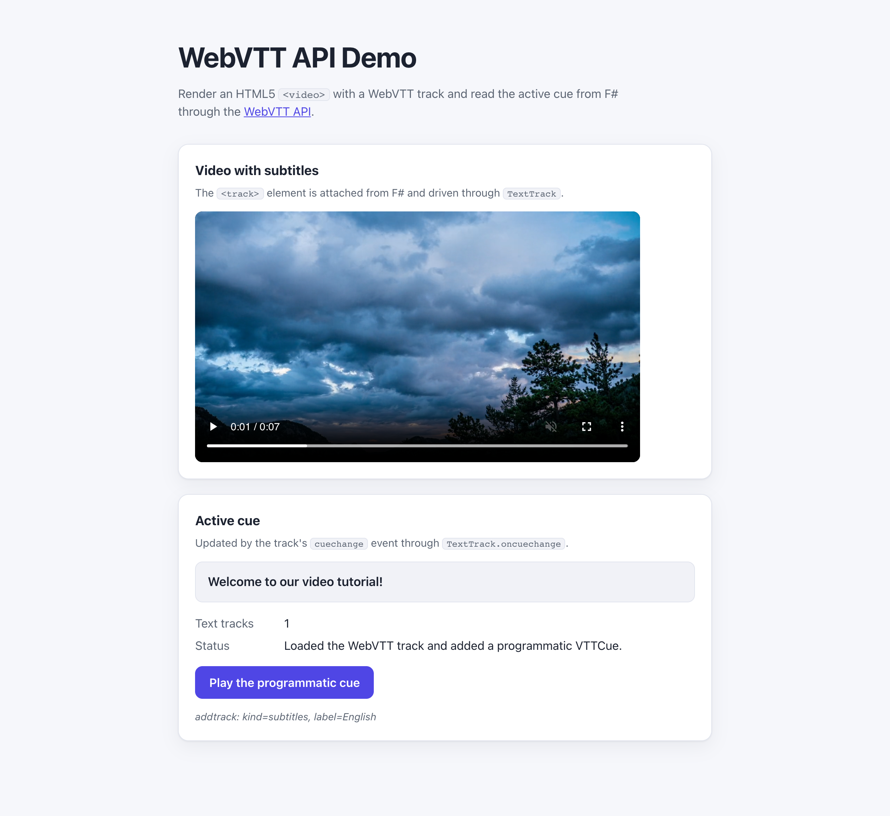

# WebSharper.WebVTT

[](https://github.com/dotnet-websharper/WebVTT)

WebSharper bindings for the [WebVTT API](https://developer.mozilla.org/en-US/docs/Web/API/WebVTT_API) —
timed text tracks (subtitles, captions, and metadata) for HTML5 media elements, from F# and C# web apps.

This repository contains:

| Project | Purpose |
| --- | --- |
| `WebSharper.WebVTT` | The binding: WIG definitions for `TextTrack`, `TextTrackCue`, `TextTrackCueList`, `TextTrackList`, `VTTCue`, `VTTRegion`, `TrackEvent`, and the `VTTCue*` enums. |
| `WebSharper.WebVTT.Sample` | An ASP.NET Core SPA that plays a video with a `.vtt` track and shows the active cue. |

## Live demos

**Try it live:** [Open the sample in your browser](https://dotnet-websharper.github.io/WebVTT/)



The sample doubles as the binding's [test case](#running-the-sample): it renders a video with a WebVTT track and shows the active cue.

- **Sample (this repository):** <https://dotnet-websharper.github.io/WebVTT/>
- **Source repository:** <https://github.com/dotnet-websharper/WebVTT>
- **WebSharper bindings:** <https://websharper.com/bindings>

## Features

- `TextTrack` with `mode`, `kind`, `label`, `language`, `id`, `cues`, and `activeCues`.
- `TextTrack.addCue` / `removeCue` for programmatically authored cues.
- `TextTrack.oncuechange` through the typed `TextTrack.OnCueChange` handler.
- `TextTrackCueList` / `TextTrackList` with `length`, `getCueById` / `getTrackById`, and an indexer on `TextTrackCueList`.
- `VTTCue` with `startTime`, `endTime`, `text`, `line`, `position`, `size`, `align`, `vertical`, `region`, and `getCueAsHTML`.
- `VTTRegion`, `TrackEvent`, and the `VTTCueVertical`, `VTTCueLineAlign`, `VTTCuePositionAlign`, and `VTTCueAlign` enums.

## Installation

The binding is not currently published to NuGet. Reference the project from source:

```bash
git clone https://github.com/dotnet-websharper/WebVTT.git
```

```xml
<ItemGroup>
  <ProjectReference Include="path/to/WebSharper.WebVTT/WebSharper.WebVTT.fsproj" />
</ItemGroup>
```

## Usage

```fsharp
namespace WebSharper.WebVTT.Demo

open WebSharper
open WebSharper.JavaScript
open WebSharper.WebVTT

[<JavaScript>]
module Demo =

    let showActiveCue (track: TextTrack) =
        let active = track.ActiveCues
        if active.Length > 0 then
            Console.Log("Active cue:", active.[0].Text)
        else
            Console.Log("No active cue.")

    let attachTrack (video: HTMLVideoElement) =
        // Create and attach a <track> element, then work with the resulting TextTrack.
        let trackEl = JS.Document.CreateElement("track")
        trackEl?kind <- "subtitles"
        trackEl?label <- "English"
        trackEl?srclang <- "en"
        trackEl?src <- "subtitles.vtt"
        trackEl?``default`` <- true
        video.AppendChild(trackEl) |> ignore

        let track = trackEl?track |> As<TextTrack>
        track.Mode <- "hidden"

        // React to cue changes instead of polling the video with timeupdate.
        track.OnCueChange <- fun _ -> showActiveCue track

        // A cue authored in F#; add it after the .vtt resource has loaded.
        let cue = VTTCue(2.0, 2.9, "This cue was added with TextTrack.addCue().")
        trackEl.AddEventListener("load", fun (_: Dom.Event) ->
            track.AddCue(cue)
        )

    let watchTrackList (video: HTMLVideoElement) =
        // textTracks is a TextTrackList; addtrack/removetrack report a TrackEvent.
        let tracks = video?textTracks |> As<TextTrackList>
        Console.Log("Text tracks:", tracks.Length)
        tracks.OnAddTrack <- fun (ev: TrackEvent) ->
            let added = ev.Track |> As<TextTrack>
            Console.Log("Added track:", added.Kind, added.Label)
```

The sample in this repository uses these calls inside a WebSharper.UI template; the
`cuechange` handler updates a `Var` that is bound into the page, so the active cue is
shown without polling `currentTime`.

## Running the sample

Build the sample in Release and serve its static output:

```bash
dotnet build WebSharper.WebVTT.Sample/WebSharper.WebVTT.Sample.fsproj -c Release
python3 -m http.server -d WebSharper.WebVTT.Sample/wwwroot 5676
```

Open <http://localhost:5676/>. The server must send `text/vtt` for `subtitles.vtt`
(Python's `http.server` does); the ASP.NET Core host is configured to do the same.

Alternatively, run the ASP.NET Core host:

```bash
dotnet run --project WebSharper.WebVTT.Sample
```

Press play, or use **Play the programmatic cue** to jump to the cue that is added
from F# through `TextTrack.addCue()`.

## Building from source

### Prerequisites

- [.NET SDK 10](https://dotnet.microsoft.com/download) or later.

### Build

```bash
dotnet build WebSharper.WebVTT.sln -c Release
```

The binding project targets `netstandard2.0`; the sample targets `net10.0`.
Dependencies are restored with Paket:

```bash
dotnet tool restore
dotnet paket restore
```

## Deployment

Pushing to `main` triggers `.github/workflows/ghpages.yml`, which builds the sample in Release
and publishes `WebSharper.WebVTT.Sample/wwwroot` to the `gh-pages` branch.

## Repository layout

```
WebSharper.WebVTT/              # binding (WIG definitions)
  Main.fs
WebSharper.WebVTT.Sample/       # ASP.NET Core SPA demo
  Client.fs
  Startup.fs
  wwwroot/
    index.html
    site.css
    sample.mp4
    subtitles.vtt
docs/sample.png                 # screenshot of the running sample
.github/workflows/ghpages.yml   # build + deploy the sample to GitHub Pages
```

## Notes on the API

- **Track modes:** a track must be `"hidden"` or `"showing"` for `cuechange` events to fire.
  `"disabled"` tracks produce no events. The sample sets `TextTrack.Mode <- "hidden"`.
- **Active cues:** `TextTrack.ActiveCues` returns a `TextTrackCueList` whose indexer
  (`activeCues.[0]`) gives the currently active cue. `TextTrack.Cues` returns all loaded cues.
- **Programmatic cues:** `TextTrack.AddCue` adds a `VTTCue` to the track. If the track is
  backed by a `.vtt` resource, add the cue after the track element's `load` event; adding it
  before the resource is fetched can be discarded when the fetched cue list is applied.
- **Cue alignment:** `VTTCue.Vertical` uses the `VTTCueVertical` enum (`rl`, `lr`), and
  `LineAlign`, `PositionAlign`, and `Align` use their matching enums.
- **Graceful degradation:** probe `globalThis.VTTCue` before relying on the API. Browsers
  without WebVTT support leave `TextTrack` objects unavailable.

## License

Apache 2.0 — see [LICENSE.md](LICENSE.md).
